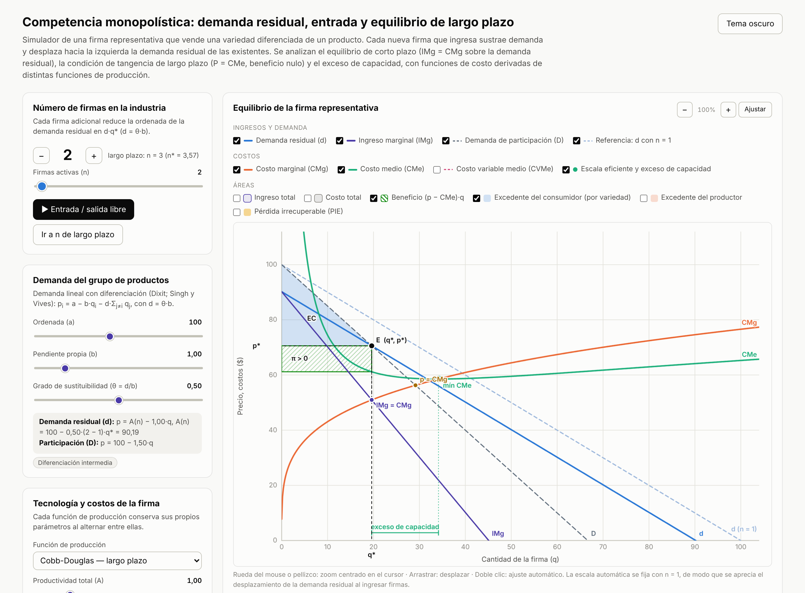
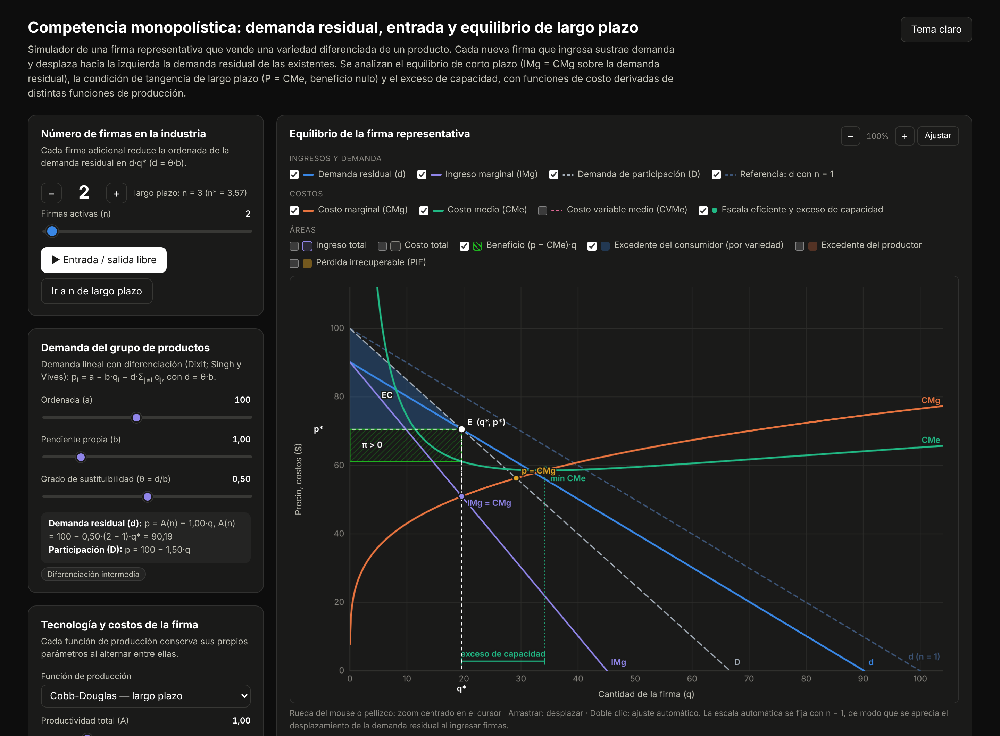

# Competencia monopolística: demanda residual, entrada y equilibrio de largo plazo

Simulador interactivo, en un único archivo HTML autocontenido, de una firma representativa en competencia monopolística. Cada nueva firma que ingresa a la industria sustrae demanda y desplaza hacia el origen la demanda residual de las existentes; el simulador resuelve el equilibrio de corto plazo (IMg = CMg sobre la demanda residual), el número de firmas compatible con la libre entrada, la condición de tangencia de Chamberlin (p = CMe) y el exceso de capacidad, con funciones de costo derivadas de seis funciones de producción.

**[▶ Abrir el simulador](https://fcontiggiani.github.io/competencia-monopolistica/competencia_monopolistica.html)**



<details>
<summary>Versión en tema oscuro</summary>



</details>

## Modelo económico

**Demanda del grupo de productos.** Un consumidor representativo con utilidad cuasilineal

```
U = a·Σ qᵢ − ½·b·Σ qᵢ² − d·Σ_{i<j} qᵢ·qⱼ + m,      d = θ·b,  0 ≤ θ ≤ 1
```

genera el sistema lineal de demandas diferenciadas (Dixit, 1979; Singh y Vives, 1984):

```
pᵢ = a − b·qᵢ − d·Σ_{j≠i} qⱼ
```

El parámetro θ = d/b mide el **grado de sustituibilidad** entre variedades: θ = 0 reproduce n monopolios independientes; θ = 1, un bien homogéneo (oligopolio de Cournot).

**Demanda residual y demanda de participación.** Si las n − 1 rivales producen q̄, la firma enfrenta la demanda residual

```
d:  p = A(n) − b·q,      A(n) = a − d·(n − 1)·q̄
```

Cada ingreso de una firma reduce la ordenada A(n): la demanda residual se desplaza paralelamente hacia el origen y, dado el precio, se vuelve más elástica. El simulador traza además la **demanda de participación** de Chamberlin (todas las firmas varían q a la vez), D: p = a − [b + d(n − 1)]·q, cuya intersección con d determina el punto de equilibrio simétrico.

**Corto plazo (n dado).** Equilibrio de Nash simétrico en cantidades:

```
CPO de la firma:   A − 2b·q = CMg(q)                      (IMg_d = CMg)
Simetría q = q̄:    a − [2b + d(n − 1)]·q* = CMg(q*)
CSO:               −2b − C''(q*) < 0
Regla de precios:  (p − CMg)/p = 1/|ε_d|,   |ε_d| = p/(b·q)   (valor absoluto)
```

El simulador verifica numéricamente que la solución simétrica sea la mejor respuesta global de la firma y advierte cuando no lo es.

**Largo plazo (libre entrada y salida).** Las firmas ingresan mientras π > 0. El equilibrio combina la CPO con la condición de beneficio nulo:

```
IMg_d(q*) = CMg(q*)   y   p* = CMe(q*)   ⇒   −b = CMe'(q*)   (tangencia de d con el CMe)
```

Como la demanda residual tiene pendiente negativa, la tangencia se produce en el **tramo decreciente del CMe**, a la izquierda de la escala eficiente: **exceso de capacidad** (Chamberlin, 1933). El simulador calcula π(n) para n = 1, …, 60, el valor continuo n* que resuelve π(n*) = 0 (tangencia exacta) y el entero de largo plazo n_LP = ⌊n*⌋, es decir, el mayor número de firmas con π ≥ 0 (la firma n_LP + 1 tendría pérdidas).

Una observación útil para la clase: como la tangencia exige CMe'(q*) = −b, la **escala de producción de largo plazo de cada firma no depende de θ**; el grado de sustituibilidad solo determina cuántas firmas caben en el mercado.

**Bienestar con n dado.** Con W = U − Σ C(qᵢ), en el simétrico:

| Medida | Expresión |
|---|---|
| Excedente del consumidor por variedad | ECᵢ = ½·[b + d(n − 1)]·q² (triángulo bajo D) |
| Excedente del consumidor de mercado | EC = n·ECᵢ |
| Excedente del productor por firma | EP = p·q − CV(q) = ∫₀^q [p − CMg(s)] ds |
| Beneficio | π = EP − CF = (p − CMe)·q |
| Asignación eficiente (n dado) | ∂W/∂qᵢ = 0  ⇔  a − [b + d(n − 1)]·qᵉ = CMg(qᵉ) |
| Pérdida irrecuperable de eficiencia por firma | PIE = ∫ de q* a qᵉ de [p_D(s) − CMg(s)] ds |

La tabla comparativa contrasta monopolio (n = 1), la situación vigente, el equilibrio de largo plazo y la asignación eficiente con el n vigente. El margen p − CMg > 0 que persiste en el largo plazo es la contrapartida de la variedad de productos (Dixit y Stiglitz, 1977): el número de variedades que surge con libre entrada no coincide, en general, con el socialmente óptimo.

**Funciones de costo.** Las versiones de largo plazo son funciones de costo duales, obtenidas de min wL + rK sujeto a f(K, L) = q. A todas se suma un costo fijo de operar F, condición necesaria para que la libre entrada converja a un número finito de firmas cuando el CMe no tiene forma de U.

| Tecnología | Función de producción | Función de costo |
|---|---|---|
| Cobb-Douglas (LP) | q = A·K^α·L^β, ν = α + β | C = F + ν·(q/A)^(1/ν)·(r/α)^(α/ν)·(w/β)^(β/ν) |
| Cobb-Douglas (CP) | q = A·K̄^α·L^β | C = r·K̄ + F + w·(q/(A·K̄^α))^(1/β) |
| CES (LP) | q = A·[α·K^ρ + (1−α)·L^ρ]^(ν/ρ), ρ = (σ−1)/σ | C = F + c(w,r)·(q/A)^(1/ν), c = [α^σ r^(1−σ) + (1−α)^σ w^(1−σ)]^(1/(1−σ)) |
| Leontief (LP) | q = mín(K/v_K, L/v_L) | C = F + (r·v_K + w·v_L)·q |
| Sustitutos perfectos (LP) | q = a_K·K + a_L·L | C = F + mín(r/a_K, w/a_L)·q |
| Cúbica (CP) | q = A·K̄^θ_K·(c₁L² − c₂L³), L ≤ L̄ = 2c₁/(3c₂) | C = r·K̄ + F + w·L(q), con capacidad máxima q̄ = q(L̄) |

Con Leontief y sustitutos perfectos el CMg es constante y el CMe decrece monótonamente (no hay escala eficiente finita): el exceso de capacidad se reporta como ilimitado. Con la tecnología cúbica las curvas de costo tienen forma de U y existe una capacidad máxima.

**Casos que se señalan explícitamente:** beneficios extraordinarios (incentivo a la entrada), pérdidas (incentivo a la salida), cierre de corto plazo (p < CVMe), equilibrio de largo plazo con tangencia exacta o con número entero de firmas, solución de esquina por capacidad, industria inviable (π(1) < 0) y ausencia de equilibrio simétrico.

## Controles

| Control | Rango | Efecto |
|---|---|---|
| Número de firmas n | 1–60 (deslizador y botones −/+) | Desplaza la demanda residual; actualiza el equilibrio y el panel π(n) |
| ▶ Entrada / salida libre | Animación | Agrega o retira una firma por paso hasta n_LP |
| Ir a n de largo plazo | Botón | Fija n = n_LP |
| Panel π(n) | Clic | Fija n en el valor señalado |
| Ordenada a, pendiente propia b | 20–200 / 0,2–5 | Tamaño del mercado y pendiente de la demanda residual |
| Grado de sustituibilidad θ = d/b | 0–1 | Intensidad con que cada rival sustrae demanda |
| Función de producción | 6 tecnologías | Cambia la estructura de costos; cada tecnología conserva sus parámetros |
| Parámetros tecnológicos (A, α, β, σ, ν, K̄, v, a, c₁, c₂, θ_K) | Según tecnología | Desplazan y rotan CMg, CMe y CVMe |
| Salario w y costo del capital r | 1–30 | Precios de los factores |
| Costo fijo de operar F | 0–2000 | Desplaza el CMe; determina cuántas firmas caben en el mercado |
| Casillas de curvas | d, IMg, D, d con n = 1, CMg, CMe, CVMe, escala eficiente | Muestran u ocultan cada curva o marca |
| Casillas de áreas | IT, CT, beneficio, EC, EP, PIE | Muestran u ocultan cada área sombreada |
| Zoom y desplazamiento | Rueda, pellizco, arrastre, botones −/+ | Zoom centrado en el cursor; doble clic o «Ajustar» restablece la vista |
| Tema claro/oscuro | Botón superior | Por defecto sigue la preferencia del sistema; la elección se recuerda |

La escala automática del gráfico principal se ancla en la demanda con n = 1 (no se recalcula al cambiar n), de modo que el ingreso de firmas se percibe como un desplazamiento de la demanda residual y no como un cambio de escala.

**Paneles de resultados.** Firma: q*, p*, A(n), IT, CT, CF, CMe, CMg = IMg, π, |ε| sobre d y sobre D, índice de Lerner, escala eficiente y exceso de capacidad. Industria: n, Q = n·q*, beneficio de la industria, excedentes de mercado, bienestar total, PIE, n* continuo y n de largo plazo. Una sección plegable desarrolla la derivación analítica con los valores vigentes.

## Requisitos técnicos

- Archivo único `competencia_monopolistica.html` (HTML, CSS y JavaScript inline), sin bibliotecas externas ni CDN. Los gráficos usan Canvas 2D nativo.
- Funciona en cualquier navegador moderno con JavaScript habilitado, sin conexión una vez descargado.
- La preferencia de tema se guarda en `localStorage`, protegido con `try/catch` para entornos con restricciones (iframes de Moodle).
- Diseño adaptable: en pantallas angostas los controles se apilan sobre los gráficos.
- El motor matemático (bloque `MATH-START` / `MATH-END`) se validó en Node.js: CPO, verificación de Nash, beneficio nulo y tangencia CMe'(q*) = −b en n*, y el caso analítico de Leontief (n* = 5 con los valores por defecto, θ = 0,5).

## Actualización

Para publicar una nueva versión, volver a subir `competencia_monopolistica.html` con el mismo nombre (*Add file → Upload files*, confirmar en `main`). GitHub Pages actualiza la URL automáticamente; si el navegador conserva la versión anterior, forzar la recarga con Ctrl+F5.

## Referencias

- Chamberlin, E. H. (1933). *The Theory of Monopolistic Competition*. Harvard University Press.
- Dixit, A. (1979). A model of duopoly suggesting a theory of entry barriers. *Bell Journal of Economics*, 10(1), 20–32.
- Dixit, A. y Stiglitz, J. (1977). Monopolistic competition and optimum product diversity. *American Economic Review*, 67(3), 297–308.
- Singh, N. y Vives, X. (1984). Price and quantity competition in a differentiated duopoly. *RAND Journal of Economics*, 15(4), 546–554.
- Pindyck, R. y Rubinfeld, D. *Microeconomía*, cap. 12. Varian, H. *Microeconomía intermedia*, cap. 25.

## Licencia y uso

Material desarrollado con fines exclusivamente didácticos. Los valores numéricos son ilustrativos. Se autoriza su uso, adaptación y redistribución con fines educativos, citando la fuente.
